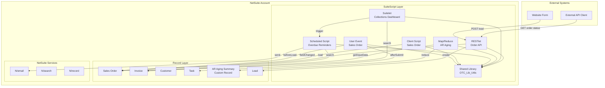

# Order-to-Cash Toolkit

[](https://github.com/NolenM93/netsuite-order-to-cash/actions/workflows/ci.yml)

A portfolio-quality Oracle NetSuite customization project demonstrating SuiteScript 2.1 development patterns within the SuiteCloud Development Framework (SDF).

**Author:** Nolen Millington ([@NolenM93](https://github.com/NolenM93))

---

## Highlights for Reviewers

- **Modern SuiteScript 2.1**: Arrow functions, template literals, destructuring, `const`/`let`, shorthand object returns
- **Proper Error Handling**: Uses `N/error.create()` with named error codes (`OTC_CREDIT_LIMIT_EXCEEDED`, etc.)
- **Configurable via Script Parameters**: Thresholds, assignees, and batch sizes are externalized—not hardcoded
- **XSS Prevention**: `escapeHtml()` helper protects INLINEHTML and Suitelet output
- **Governance Awareness**: Scheduled script checks `getRemainingUsage()` inside its loop; Map/Reduce returns search object directly from `getInputData()`
- **Smart EDIT Handling**: Credit check on EDIT only runs when customer or total changed (avoids false blocks)
- **118 Passing Tests**: Comprehensive unit tests with **93%+ code coverage** using `@oracle/suitecloud-unit-testing`
- **Clean Commits**: Logical, well-messaged commit history like a real developer workflow

> **Honesty Note:** This project is built and unit-tested against SuiteCloud mocks. It has not been deployed to a production NetSuite account. No fake metrics or fictional client names.

---

## Overview

This project implements an **Order-to-Cash Toolkit** for a fictional small wholesale distributor, **Acme Wholesale Distributors**. It showcases real-world NetSuite customization patterns including:

- User Event scripts for server-side validation and automation
- Client Scripts for form interactivity and validation
- Scheduled Scripts with governance awareness
- Map/Reduce scripts for bulk data processing
- Suitelets for custom UI dashboards
- RESTlets for external system integration
- Shared utility libraries for testable, reusable code

## Fictional Scenario

**Acme Wholesale Distributors** is a small B2B company selling industrial supplies. They need:

1. Real-time credit monitoring on sales orders
2. Automated validation to prevent orders exceeding credit limits
3. Follow-up task creation for large orders
4. Daily reminder emails for overdue invoices
5. AR aging summaries for collections management
6. An internal collections dashboard
7. External API access for their website to check order status and submit leads

## Script Type to Feature Mapping

| Script Type | Feature | File |
|-------------|---------|------|
| User Event | Credit status banner, validation, task creation | `OTC_UE_SalesOrder.js` |
| Client Script | Form defaults, discount calculation, validation | `OTC_CS_SalesOrder.js` |
| Scheduled | Daily overdue invoice reminders | `OTC_SS_OverdueReminder.js` |
| Map/Reduce | Customer AR aging summary | `OTC_MR_ARAgingSummary.js` |
| Suitelet | Collections Dashboard | `OTC_SL_CollectionsDashboard.js` |
| RESTlet | Order status API, lead creation | `OTC_RL_OrderAPI.js` |
| Library | Shared utility functions | `OTC_Lib_Utils.js` |

## Architecture



## Project Structure

```
netsuite-order-to-cash/
├── .eslintrc.js                          # ESLint config for SuiteScript 2.1
├── .github/workflows/ci.yml              # GitHub Actions CI
├── .gitignore
├── LICENSE                               # MIT License
├── README.md
├── jest.config.js                        # Jest test configuration
├── package.json
├── suitecloud.config.js                  # SuiteCloud SDK config
├── __tests__/
│   ├── setup.js
│   ├── lib/OTC_Lib_Utils.test.js
│   ├── UserEvent/OTC_UE_SalesOrder.test.js
│   ├── Client/OTC_CS_SalesOrder.test.js
│   ├── Scheduled/OTC_SS_OverdueReminder.test.js
│   ├── MapReduce/OTC_MR_ARAgingSummary.test.js
│   ├── Suitelet/OTC_SL_CollectionsDashboard.test.js
│   └── RESTlet/OTC_RL_OrderAPI.test.js
├── docs/
│   ├── 01-user-event-sales-order.md
│   ├── 02-client-script-sales-order.md
│   ├── 03-scheduled-overdue-reminder.md
│   ├── 04-map-reduce-ar-aging.md
│   ├── 05-suitelet-collections-dashboard.md
│   └── 06-restlet-order-api.md
└── src/
    ├── manifest.xml
    ├── deploy.xml
    ├── FileCabinet/SuiteScripts/OrderToCash/
    │   ├── lib/OTC_Lib_Utils.js
    │   ├── UserEvent/OTC_UE_SalesOrder.js
    │   ├── Client/OTC_CS_SalesOrder.js
    │   ├── Scheduled/OTC_SS_OverdueReminder.js
    │   ├── MapReduce/OTC_MR_ARAgingSummary.js
    │   ├── Suitelet/OTC_SL_CollectionsDashboard.js
    │   ├── Suitelet/OTC_SL_CollectionsDashboard_Client.js
    │   └── RESTlet/OTC_RL_OrderAPI.js
    └── Objects/
        ├── CustomFields/custentity_otc_web_lead.xml
        ├── CustomRecords/customrecord_otc_ar_aging.xml
        ├── EmailTemplates/custemailtmpl_otc_overdue_reminder.xml
        ├── SavedSearches/customsearch_otc_overdue_invoices.xml
        └── Scripts/*.xml (6 script deployments with parameters)
```

## Deployment to NetSuite

### Prerequisites

1. NetSuite account with SuiteCloud Development Framework enabled
2. Node.js 18+ installed
3. SuiteCloud CLI installed (`npm install -g @oracle/suitecloud-cli`)

### Setup

```bash
git clone https://github.com/NolenM93/netsuite-order-to-cash.git
cd netsuite-order-to-cash
npm install
suitecloud account:setup
```

### Validate & Deploy

```bash
# Validate project structure (requires authenticated account)
suitecloud project:validate

# Deploy to sandbox
suitecloud project:deploy --accountspecificvalues WARNING
```

### Post-Deployment Steps

1. Verify script deployments are active in Setup > Scripting > Script Deployments
2. Configure script parameters (large order threshold, email sender, etc.)
3. Test User Event script on a sales order
4. Run the Map/Reduce script manually to populate AR aging records
5. Access the Collections Dashboard via the Suitelet URL
6. Configure RESTlet access for external integrations

## Governance Considerations

| Script Type | Governance Units | Key Considerations |
|-------------|------------------|-------------------|
| User Event | 1,000 units | Keep beforeSubmit light; move heavy work to afterSubmit |
| Client Script | N/A (client-side) | Minimize server calls; use promises for async ops |
| Scheduled | 10,000 units | Check `getRemainingUsage()` before each operation |
| Map/Reduce | 10,000/stage | Return search from `getInputData()`; handle errors in summarize |
| Suitelet | 10,000 units | Paginate large result sets |
| RESTlet | 5,000 units | Validate input early; fail fast |

### Governance Best Practices in This Project

- **Scheduled Script**: Checks `getRemainingUsage()` inside the processing loop; stops gracefully when threshold reached
- **Map/Reduce**: Returns search object directly from `getInputData()` (no memory buildup); comprehensive error reporting in `summarize()`
- **Utility Functions**: Pure functions that don't consume governance units

## Testing

### Run Unit Tests

```bash
npm test                    # Run all tests
npm run test:coverage       # Run with coverage report
npx jest __tests__/lib/     # Run specific test folder
```

### Run Linting

```bash
npm run lint                # Check for linting errors
npm run lint:fix            # Auto-fix linting errors
```

### Test Results

- **118 tests passing** across 7 test suites
- **ESLint: Clean** (0 errors, 0 warnings)
- **CI: Passing** ✅

### Code Coverage

| Metric | Coverage | Threshold |
|--------|----------|-----------|
| Statements | 93.52% | 85% |
| Branches | 83.97% | 75% |
| Functions | 96.51% | 85% |
| Lines | 93.38% | 85% |

Coverage is measured using `@oracle/suitecloud-unit-testing` with `babel-plugin-transform-amd-to-commonjs` to convert SuiteScript's AMD modules to CommonJS for Jest instrumentation.

## When to Use Workflows Instead of Scripts

| Use Case | Workflow | Script |
|----------|----------|--------|
| Simple field updates based on conditions | ✅ Better | Overkill |
| Email notifications on record save | ✅ Better | Overkill |
| Complex calculations or external API calls | Limited | ✅ Better |
| Bulk data processing | Not suitable | ✅ Required |
| Custom UI/dashboards | Not suitable | ✅ Required |
| External API endpoints | Not suitable | ✅ Required |
| Reusable logic across multiple records | Duplicated | ✅ Better (libraries) |
| Non-technical user modifications | ✅ Better | Requires dev |

In this project, scripts are appropriate because we need:
- Complex credit calculations with configurable thresholds
- External API integration (RESTlet)
- Custom dashboard UI (Suitelet)
- Bulk AR aging calculations (Map/Reduce)
- Governance-aware batch processing (Scheduled)

## Feature Documentation

Detailed specifications for each feature are in the `docs/` folder:

- [User Event - Sales Order](docs/01-user-event-sales-order.md)
- [Client Script - Sales Order](docs/02-client-script-sales-order.md)
- [Scheduled - Overdue Reminder](docs/03-scheduled-overdue-reminder.md)
- [Map/Reduce - AR Aging](docs/04-map-reduce-ar-aging.md)
- [Suitelet - Collections Dashboard](docs/05-suitelet-collections-dashboard.md)
- [RESTlet - Order API](docs/06-restlet-order-api.md)

## Possible Next Steps

If this were a real consulting engagement, logical next steps might include:

1. **Credit Hold Workflow**: Auto-place orders on hold when customer exceeds limit
2. **Payment Portal Integration**: Customer self-service for viewing/paying invoices
3. **Dunning Management**: Escalating reminder sequences based on aging
4. **Dashboard Enhancements**: Charts, export to CSV, scheduled reports
5. **Multi-Currency Support**: Handle customers with different currencies
6. **Integration with External CRM**: Sync leads to Salesforce/HubSpot
7. **Approval Workflow**: Manager approval for orders over credit limit

## Development Notes

- Built with SuiteScript 2.1 (ES2021 features: arrow functions, template literals, nullish coalescing)
- Uses AMD module pattern (`define()`) per SuiteScript 2.x requirements
- JSDoc comments on all entry points
- Shared library contains pure functions for testability
- All scripts include proper `@NApiVersion`, `@NScriptType`, `@NModuleScope` annotations
- Named error codes for consistent error handling (`OTC_*` prefix)

## License

MIT License - See [LICENSE](LICENSE) for details.

---

*This is a demonstration project for portfolio purposes. Acme Wholesale Distributors is a fictional company.*
