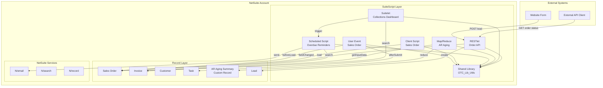
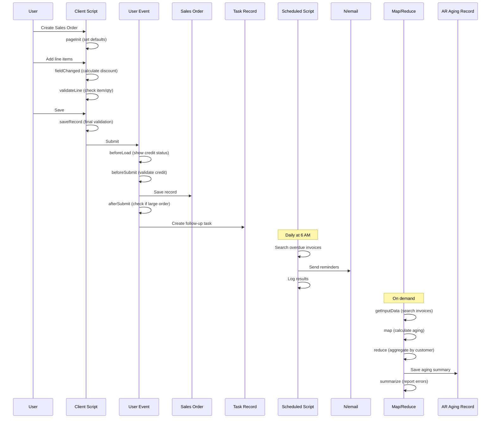

# Order-to-Cash Toolkit

A portfolio-quality Oracle NetSuite customization project demonstrating SuiteScript 2.1 development patterns within the SuiteCloud Development Framework (SDF).

**Author:** Nolen Millington ([@NolenM93](https://github.com/NolenM93))

## Overview

This project implements an **Order-to-Cash Toolkit** for a fictional small wholesale distributor, **Acme Wholesale Distributors**. It showcases real-world NetSuite customization patterns including:

- User Event scripts for server-side validation and automation
- Client Scripts for form interactivity and validation
- Scheduled Scripts with governance awareness
- Map/Reduce scripts for bulk data processing
- Suitelets for custom UI dashboards
- RESTlets for external system integration
- Shared utility libraries for testable, reusable code

> **Note:** This is a demonstration project built and tested against SuiteCloud mocks. It has not been deployed to a production NetSuite account.

## Fictional Scenario

**Acme Wholesale Distributors** is a small B2B company selling industrial supplies. They need:

1. Real-time credit monitoring on sales orders
2. Automated validation to prevent orders exceeding credit limits
3. Follow-up task creation for large orders
4. Daily reminder emails for overdue invoices
5. AR aging summaries for collections management
6. An internal collections dashboard
7. External API access for their website to check order status and submit leads

## Script Type to Feature Mapping

| Script Type | Feature | File |
|-------------|---------|------|
| User Event | Credit status banner, validation, task creation | `OTC_UE_SalesOrder.js` |
| Client Script | Form defaults, discount calculation, validation | `OTC_CS_SalesOrder.js` |
| Scheduled | Daily overdue invoice reminders | `OTC_SS_OverdueReminder.js` |
| Map/Reduce | Customer AR aging summary | `OTC_MR_ARAgingSummary.js` |
| Suitelet | Collections Dashboard | `OTC_SL_CollectionsDashboard.js` |
| RESTlet | Order status API, lead creation | `OTC_RL_OrderAPI.js` |
| Library | Shared utility functions | `OTC_Lib_Utils.js` |

## Architecture



## Data Flow: Order-to-Cash Process



## Project Structure

```
├── src/
│   ├── manifest.xml                    # SDF project manifest
│   ├── deploy.xml                      # Deployment configuration
│   ├── FileCabinet/
│   │   └── SuiteScripts/
│   │       └── OrderToCash/
│   │           ├── lib/
│   │           │   └── OTC_Lib_Utils.js
│   │           ├── UserEvent/
│   │           │   └── OTC_UE_SalesOrder.js
│   │           ├── Client/
│   │           │   └── OTC_CS_SalesOrder.js
│   │           ├── Scheduled/
│   │           │   └── OTC_SS_OverdueReminder.js
│   │           ├── MapReduce/
│   │           │   └── OTC_MR_ARAgingSummary.js
│   │           ├── Suitelet/
│   │           │   ├── OTC_SL_CollectionsDashboard.js
│   │           │   └── OTC_SL_CollectionsDashboard_Client.js
│   │           └── RESTlet/
│   │               └── OTC_RL_OrderAPI.js
│   └── Objects/
│       ├── CustomFields/
│       │   └── custentity_otc_web_lead.xml
│       ├── CustomRecords/
│       │   └── customrecord_otc_ar_aging.xml
│       ├── Scripts/
│       │   ├── customscript_otc_ue_salesorder.xml
│       │   ├── customscript_otc_cs_salesorder.xml
│       │   ├── customscript_otc_ss_overdue_reminder.xml
│       │   ├── customscript_otc_mr_ar_aging.xml
│       │   ├── customscript_otc_sl_collections.xml
│       │   └── customscript_otc_rl_order_api.xml
│       ├── SavedSearches/
│       │   └── customsearch_otc_overdue_invoices.xml
│       └── EmailTemplates/
│           └── custemailtmpl_otc_overdue_reminder.xml
├── __tests__/
│   ├── setup.js
│   ├── lib/
│   ├── UserEvent/
│   ├── Client/
│   ├── Scheduled/
│   ├── MapReduce/
│   ├── Suitelet/
│   └── RESTlet/
├── docs/
│   ├── 01-user-event-sales-order.md
│   ├── 02-client-script-sales-order.md
│   ├── 03-scheduled-overdue-reminder.md
│   ├── 04-map-reduce-ar-aging.md
│   ├── 05-suitelet-collections-dashboard.md
│   └── 06-restlet-order-api.md
├── package.json
├── suitecloud.config.js
├── jest.config.js
├── .eslintrc.js
├── .gitignore
└── LICENSE
```

## Deployment to NetSuite

### Prerequisites

1. NetSuite account with SuiteCloud Development Framework enabled
2. Node.js 18+ installed
3. SuiteCloud CLI installed (`npm install -g @oracle/suitecloud-cli`)

### Setup

```bash
# Clone the repository
git clone https://github.com/NolenM93/netsuite-order-to-cash.git
cd netsuite-order-to-cash

# Install dependencies
npm install

# Authenticate with NetSuite (interactive)
suitecloud account:setup
```

### Validate Project

```bash
# Validate SDF project structure
suitecloud project:validate
```

### Deploy to Sandbox

```bash
# Deploy to sandbox account
suitecloud project:deploy --accountspecificvalues WARNING

# Or deploy to specific account
suitecloud project:deploy --account ACCOUNT_ID
```

### Post-Deployment Steps

1. Verify script deployments are active in Setup > Scripting > Script Deployments
2. Test User Event script on a sales order
3. Run the Map/Reduce script manually to populate AR aging records
4. Access the Collections Dashboard via the Suitelet URL
5. Configure RESTlet access for external integrations

## Governance Considerations

| Script Type | Governance Units | Key Considerations |
|-------------|------------------|-------------------|
| User Event | 1,000 units | Keep beforeSubmit light; move heavy work to afterSubmit |
| Client Script | N/A (client-side) | Minimize server calls; use promises for async ops |
| Scheduled | 10,000 units | Check `getRemainingUsage()` before each operation |
| Map/Reduce | 10,000/stage | Use yielding; handle errors in summarize |
| Suitelet | 10,000 units | Paginate large result sets |
| RESTlet | 5,000 units | Validate input early; fail fast |

### Governance Best Practices in This Project

- **Scheduled Script**: Checks remaining governance before each email send; stops gracefully when threshold reached
- **Map/Reduce**: Proper error handling in each phase; comprehensive error reporting in summarize
- **Utility Functions**: Pure functions that don't consume governance units
- **Searches**: Limited result sets with pagination support

## Testing

### Run Unit Tests

```bash
# Run all tests
npm test

# Run tests with coverage
npm run test:coverage

# Run specific test file
npx jest __tests__/lib/OTC_Lib_Utils.test.js
```

### Run Linting

```bash
# Check for linting errors
npm run lint

# Auto-fix linting errors
npm run lint:fix
```

### Test Coverage

The test suite covers:

- ✅ All utility functions in the shared library
- ✅ User Event entry points (beforeLoad, beforeSubmit, afterSubmit)
- ✅ Client Script entry points (pageInit, fieldChanged, validateLine, saveRecord)
- ✅ Scheduled Script execution with governance checks
- ✅ Map/Reduce phases (getInputData, map, reduce, summarize)
- ✅ Suitelet GET/POST handling
- ✅ RESTlet GET/POST with validation

## When to Use Workflows Instead of Scripts

NetSuite Workflows are a valid alternative for simpler automation. Consider workflows when:

| Use Case | Workflow | Script |
|----------|----------|--------|
| Simple field updates based on conditions | ✅ Better | Overkill |
| Email notifications on record save | ✅ Better | Overkill |
| Complex calculations or external API calls | Limited | ✅ Better |
| Bulk data processing | Not suitable | ✅ Required |
| Custom UI/dashboards | Not suitable | ✅ Required |
| External API endpoints | Not suitable | ✅ Required |
| Reusable logic across multiple records | Duplicated | ✅ Better (libraries) |
| Non-technical user modifications | ✅ Better | Requires dev |

In this project, scripts are appropriate because we need:
- Complex credit calculations
- External API integration (RESTlet)
- Custom dashboard UI (Suitelet)
- Bulk AR aging calculations (Map/Reduce)
- Governance-aware batch processing (Scheduled)

## Feature Documentation

Detailed specifications for each feature are in the `docs/` folder:

- [User Event - Sales Order](docs/01-user-event-sales-order.md)
- [Client Script - Sales Order](docs/02-client-script-sales-order.md)
- [Scheduled - Overdue Reminder](docs/03-scheduled-overdue-reminder.md)
- [Map/Reduce - AR Aging](docs/04-map-reduce-ar-aging.md)
- [Suitelet - Collections Dashboard](docs/05-suitelet-collections-dashboard.md)
- [RESTlet - Order API](docs/06-restlet-order-api.md)

## Development Notes

- Built with SuiteScript 2.1 (modern JavaScript, arrow functions, const/let)
- Uses AMD module pattern (`define()`) per SuiteScript 2.x requirements
- JSDoc comments on all entry points
- Shared library contains pure functions for testability
- All scripts include proper `@NApiVersion`, `@NScriptType`, `@NModuleScope` annotations

## License

MIT License - See [LICENSE](LICENSE) for details.

---

*This is a demonstration project for portfolio purposes. Acme Wholesale Distributors is a fictional company.*
